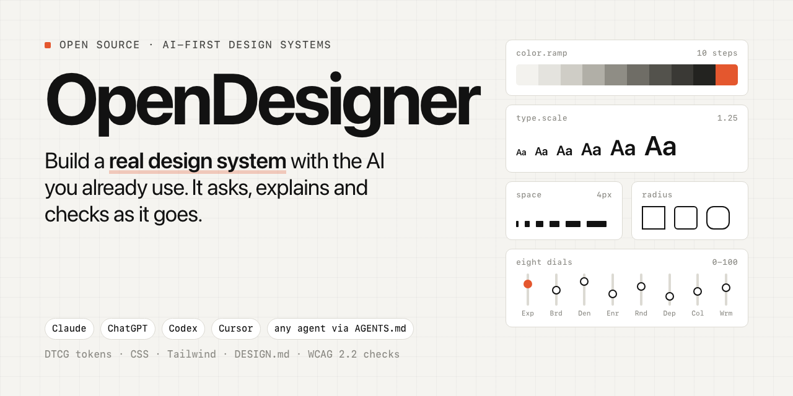
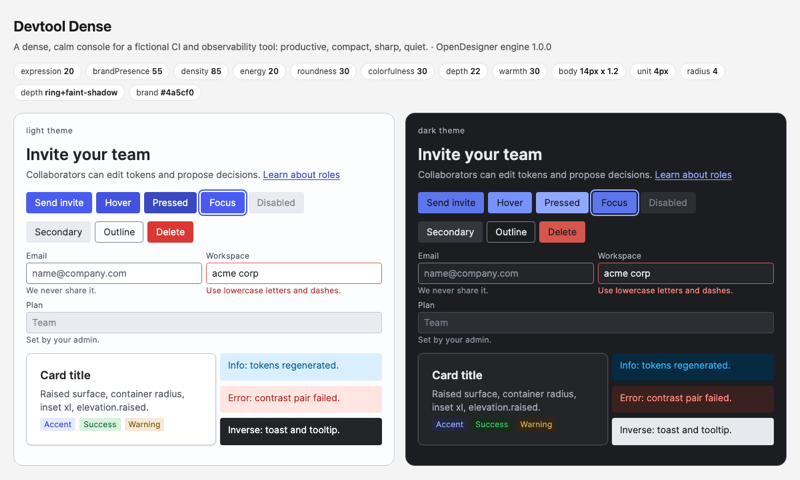
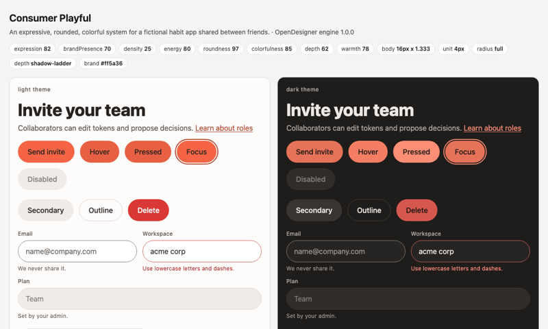
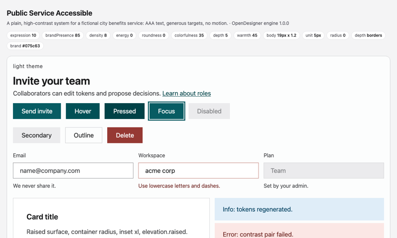

# OpenDesigner

**Make your app look good and stay consistent, with the AI you already use.**

OpenDesigner is a free, open-source add-on for AI tools like Claude, ChatGPT, Codex and Cursor. It helps you build a **design system**: the rules for how your app looks, such as colors, text sizes, spacing, corners and buttons.

It asks simple questions one at a time, shows you choices you can see, and saves your answers as files in your project.

[](LICENSE)



[Quickstart](#quickstart) · [How it works](docs/HOW-IT-WORKS.md) · [FAQ](docs/FAQ.md) · [Glossary](docs/GLOSSARY.md) · [Research](docs/RESEARCH.md) · [Privacy](docs/PRIVACY.md) · [Contributing](CONTRIBUTING.md)

## Quickstart

1. Add OpenDesigner to your AI tool. Pick yours below.
2. Say: **"Create a design system for this project."**
3. Answer about 5 short questions. In about 3 minutes you have a complete, working design system.

<details open>
<summary><b>Claude Code</b></summary>

```
/plugin marketplace add ckryptickunal/OpenDesigner
/plugin install opendesigner@opendesigner
```

</details>

<details>
<summary><b>Claude app</b> (claude.ai or Desktop)</summary>

Build the skill zip, then upload `dist/opendesigner.zip` under Customize > Skills. Code execution must be on.

```bash
git clone https://github.com/ckryptickunal/OpenDesigner && cd OpenDesigner
python3 tools/build_dist.py        # writes the zip files into dist/
```

</details>

<details>
<summary><b>Codex, Cursor, VS Code with Copilot, Gemini CLI and other agents</b></summary>

These tools read skills from `.agents/skills/`. Copy the OpenDesigner skills into your project. Tools that support Agent Plugins can also read the root `plugin.json`.

```bash
git clone https://github.com/ckryptickunal/OpenDesigner
mkdir -p your-project/.agents/skills
cp -R OpenDesigner/.agents/skills/opendesigner* your-project/.agents/skills/
```

</details>

<details>
<summary><b>ChatGPT</b> (web, any plan, nothing to install)</summary>

1. Create a Project.
2. Paste [`chatgpt-project/instructions.md`](chatgpt-project/instructions.md) (the part below its line) into the Project instructions.
3. Upload the five files in [`chatgpt-project/knowledge/`](chatgpt-project/knowledge/).

</details>

## What you get

Files in your project that any person or AI tool can read:

- **`DESIGN.md`:** your design rules, explained in plain words.
- **Design tokens:** the same rules saved as named values (colors, sizes, spacing), in the open DTCG format.
- **Code you can use right away:** CSS variables, a Tailwind theme, and Swift and Jetpack Compose files.
- **Figma variables and Paper tokens,** so your design tool matches your code.
- **A decision log:** every choice with its reason, so your team and the next AI session don't undo it.
- **An overview page** of your whole system that grows with every decision and marks what is still missing, plus a preview page with every color, size and core component.

## How it works

1. **It reads your project first,** so it doesn't ask what it can already see.
2. **It starts with a sketch.** About 5 questions give you a complete system.
3. **You zoom in only where you care:** color, text, spacing, buttons or motion. Stop whenever it's enough.
4. **It checks its own work:** readable contrast (WCAG 2.2 AA), tap targets that are big enough, visible keyboard focus and reduced motion.
5. **It writes everything down,** so later changes stay consistent.

Two things it will not do:

- **Fake what only a person should make.** For a logo, custom icons, illustration, photos or a brand typeface, it asks you.
- **Copy someone's brand.** Show it a website, screenshot or Figma file you like, and it borrows the structure and quality, never the identity.

A shortened example of a session (it shows the idea; it is not a recorded transcript):

```
You:    Create a design system for this project.
Model:  I read your project: Next.js, Tailwind, 14 colors, 3 corner sizes.
        Let's start with a 5-question sketch. First: what should people
        remember about this product?
You:    It should feel calm and fast.
        ...
Model:  Sketch done. Here are three directions for "calm and fast",
        in light and dark: [A] [B] [C]
```

The full walkthrough is in [docs/HOW-IT-WORKS.md](docs/HOW-IT-WORKS.md).

## Who it's for

- **New to design:** plain words, one question at a time, and a recommendation for every choice.
- **Designers:** it does the repetitive system work (scales, tokens, states, accessibility checks) and leaves the creative parts to you.
- **Engineers:** each decision becomes tokens, CSS variables, a Tailwind theme and a `DESIGN.md` that your code and AI agents can follow.

## Examples

Three complete systems for made-up products. Each folder has the `DESIGN.md`, the tokens, every export and a preview page.

| [Devtool Dense](examples/devtool-dense/) | [Consumer Playful](examples/consumer-playful/) | [Public Service Accessible](examples/public-service-accessible/) |
|---|---|---|
|  |  |  |
| Calm, compact, sharp: a CI console | Expressive, rounded, colorful: a habit app | Plain, high contrast, no motion: a benefits service |

You can also try the engine on its own, with no AI (Python 3.10+, nothing to install):

```bash
python3 path/to/OpenDesigner/skills/opendesigner/scripts/engine.py sketch --name "Acme" --feel friendly,minimal
```

It writes `DESIGN.md`, `PRODUCT.md` and an `opendesigner/` folder with tokens, exports and a preview.

## Why trust its advice

OpenDesigner's defaults are not taste. They come from research in this repo that anyone can check:

- 25 public design systems compared side by side, including Material, Apple HIG, Carbon, Fluent, Polaris, Primer and shadcn/ui.
- More than 500 Decision Cards. Each one covers a single design decision, with its options, a recommended default and its sources.
- Every claim cites a source or is marked as an inference.

Start with [docs/RESEARCH.md](docs/RESEARCH.md).

## Common questions

- **How long does it take?** About 3 minutes for a first complete version. Go deeper only where you want to. [More](docs/FAQ.md#getting-started)
- **Does it work with Tailwind, shadcn/ui and Figma?** Yes. It exports Tailwind and CSS, and Figma is both a source it can learn from and a place it can export to. [More](docs/FAQ.md#tools-and-hosts)
- **Is it accessible?** Yes. Contrast, target sizes, focus rings and reduced motion are built into every system it makes. [More](docs/FAQ.md#accessibility)
- **Does it send my code or data anywhere?** No. The skills and the engine run on your machine, and the engine makes no network calls. Your chat still goes to your AI provider, as with any prompt. Sharing anonymous feedback with the maintainers is off unless you say yes. [More](docs/PRIVACY.md)
- **How is it different from Claude Design, Figma Make or tweakcn?** It is open source, runs in any model, and keeps your system in open files with the evidence for each decision. [More](docs/FAQ.md#how-it-compares)
- **Does it replace designers?** No. It does what can be generated well and asks a person for the rest. [More](docs/FAQ.md#designers-brands-and-references)

## Status and roadmap

This is the first public version (0.1.0).

- **Works today:** the skills, the engine and every export format. Packaging for Claude, ChatGPT, Codex, Cursor and other agents is in the repo, with three worked examples.
- **Planned next:** choices you can click inside your AI tool, through an MCP server.
- **Help wanted:** hands-on Figma research. See the [seed issues](docs/SEED-ISSUES.md).

What has shipped is in [CHANGELOG.md](CHANGELOG.md). The full plan is in [docs/SPEC.md](docs/SPEC.md).

## Report a problem or suggest an improvement

- **While you use it:** tell your AI what went wrong. It saves the note in your project and gives you a ready-to-file GitHub link. Nothing is posted until you open the link and submit it. You can also run it yourself:

  ```bash
  python3 path/to/OpenDesigner/skills/opendesigner/scripts/engine.py feedback "the spacing question was confusing" --kind confusing
  ```

- **On GitHub:** [open an issue](https://github.com/ckryptickunal/OpenDesigner/issues/new/choose) or ask in [Discussions](https://github.com/ckryptickunal/OpenDesigner/discussions).

## Contributing

All kinds of help are welcome: research corrections, better questions, support for more AI tools, translations and examples. Start with [CONTRIBUTING.md](CONTRIBUTING.md) and the [good first issues](https://github.com/ckryptickunal/OpenDesigner/labels/good%20first%20issue).

Questions go to [Discussions](https://github.com/ckryptickunal/OpenDesigner/discussions); see [SUPPORT.md](SUPPORT.md). Everyone follows the [Code of Conduct](CODE_OF_CONDUCT.md). For security issues, see [SECURITY.md](SECURITY.md).

## Sponsors

OpenDesigner is free and open source. Sponsorship pays for maintenance, model credits for testing across AI tools, and the hosted MCP server. [Sponsor OpenDesigner](docs/SPONSORSHIP.md#for-sponsors)

<!-- Partners: large logos. Companies: small logos. Backers: names. Supported by: in-kind credit programs (never leave the wall empty). -->
<!-- When GitHub Sponsors is approved, point the link above at https://github.com/sponsors/ckryptickunal (see docs/SPONSORSHIP.md). -->

## License

Code, skills, templates and data files are under the [MIT license](LICENSE). Written research and documentation are under [CC BY 4.0](LICENSE-CONTENT), so you can reuse them with credit. That covers `research/`, `benchmarks/`, `sources/`, `traces/`, `synthesis/` Markdown and `docs/`. Product and design-system names in the research belong to their owners.

## Citation

If OpenDesigner or its research helps your work, cite it with [CITATION.cff](CITATION.cff). GitHub's "Cite this repository" button uses it.
