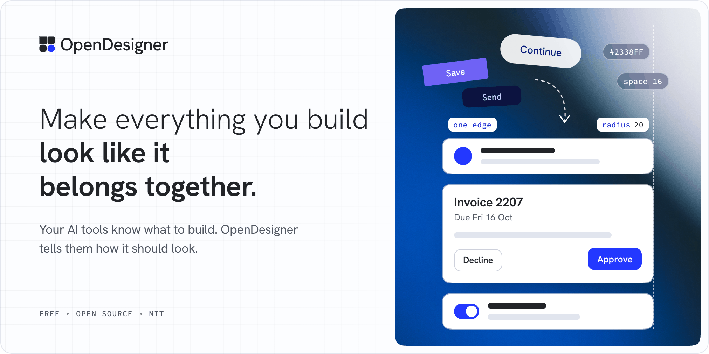
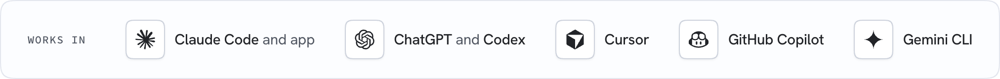
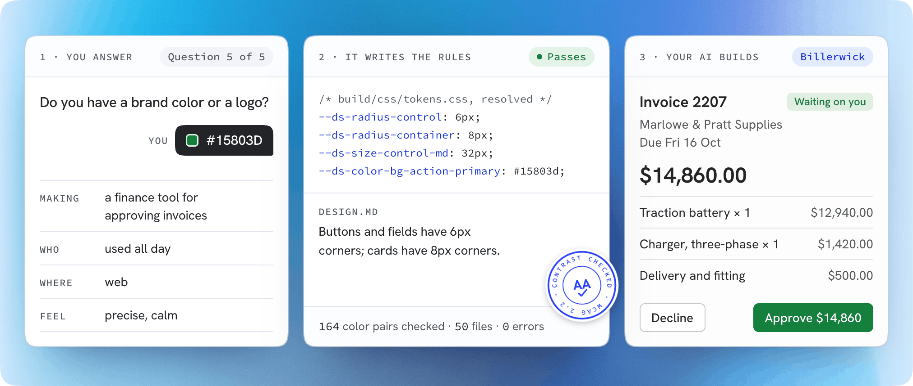
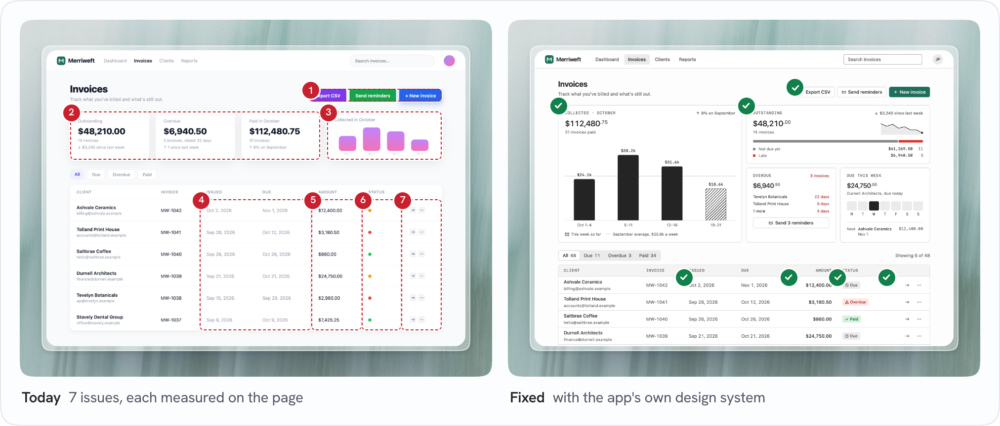
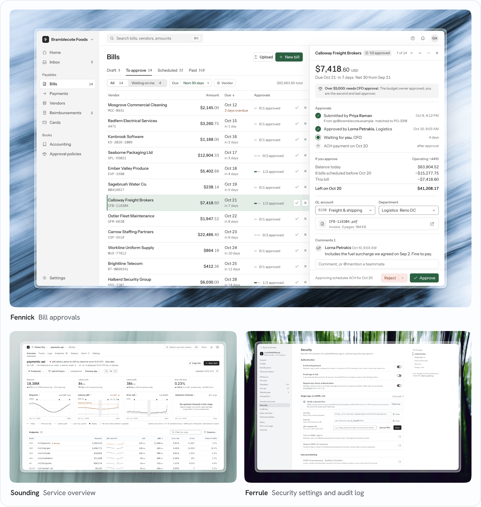
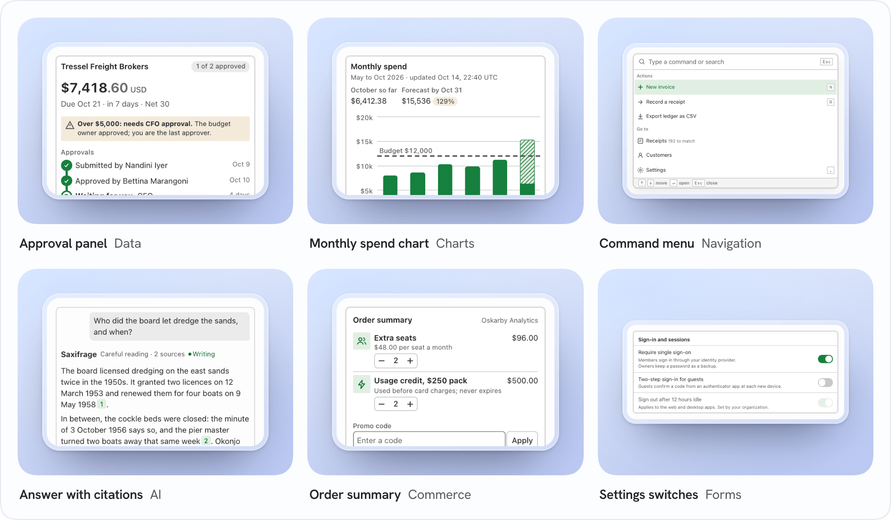

<p align="center">
  <a href="https://opendesigner.dev">
    <picture>
      <source media="(max-width: 600px)" srcset="https://raw.githubusercontent.com/ckryptickunal/OpenDesigner/main/brand/kit/readme/banner-narrow.png">
      
    </picture>
  </a>
</p>

<p align="center">
  <a href="https://opendesigner.dev"><b>Website</b></a> &nbsp;·&nbsp;
  <a href="https://opendesigner.dev/docs/">Docs</a> &nbsp;·&nbsp;
  <a href="https://opendesigner.dev/showcase/">Showcase</a> &nbsp;·&nbsp;
  <a href="#quickstart">Install</a> &nbsp;·&nbsp;
  <a href="CONTRIBUTING.md">Contribute</a> &nbsp;·&nbsp;
  <a href="https://calendar.app.google/42qSQUrBiSL4CHfv6">Book a 20-minute intro call</a>
</p>

**OpenDesigner is a free, open-source (MIT) add-on for the AI tool you already use.** It asks a few plain questions about your product and suggests an answer for each, with its reason. Then it checks that text is easy to read and saves the answers as your **design system** (the rules for how your app looks), in files that your code, your team and your next AI chat all follow.

<p align="center">
  <picture>
    <source media="(max-width: 600px)" srcset="https://raw.githubusercontent.com/ckryptickunal/OpenDesigner/main/brand/kit/readme/works-in-narrow.png">
    
  </picture>
</p>

## Quickstart

1. Add OpenDesigner to your AI tool. Pick yours below.
2. Open your project and say: **"Create a design system for this project."**
3. Answer up to five short questions. You get a complete first version right away, and you can zoom into color, type, spacing or motion whenever you like.

**Claude Code**

```
/plugin marketplace add ckryptickunal/OpenDesigner
/plugin install opendesigner@opendesigner
```

<details>
<summary><b>Claude app</b> (claude.ai or Desktop)</summary>

Build the skill zip, then upload `dist/opendesigner.zip` under Customize > Skills. Code execution must be on.

```bash
git clone https://github.com/ckryptickunal/OpenDesigner && cd OpenDesigner
python3 tools/build_dist.py        # writes the zip files into dist/
```

</details>

<details>
<summary><b>Codex, Cursor, VS Code with Copilot, Gemini CLI and other agents</b></summary>

These tools read skills from `.agents/skills/`. Copy the OpenDesigner skills into your project. Tools that support Agent Plugins can also read the root `plugin.json`.

```bash
git clone https://github.com/ckryptickunal/OpenDesigner
mkdir -p your-project/.agents/skills
cp -R OpenDesigner/.agents/skills/opendesigner* your-project/.agents/skills/
```

</details>

<details>
<summary><b>ChatGPT</b> (web, any plan, nothing to install)</summary>

1. Create a Project.
2. Paste [`chatgpt-project/instructions.md`](chatgpt-project/instructions.md) (the part below its line) into the Project instructions.
3. Upload the five files in [`chatgpt-project/knowledge/`](chatgpt-project/knowledge/).

</details>

<details>
<summary><b>No AI at all</b> (the engine on its own)</summary>

The engine is one Python file (Python 3.10 or newer, nothing to install). It writes `DESIGN.md`, `PRODUCT.md` and an `opendesigner/` folder with tokens, exports and an overview page.

```bash
python3 path/to/OpenDesigner/skills/opendesigner/scripts/engine.py sketch --name "Acme" --feel friendly,minimal
```

</details>

You need your own AI tool and Python 3.10 or newer. The engine makes no network calls; your chat still goes to your AI provider, as with any prompt ([privacy](docs/PRIVACY.md)). Step-by-step help for each tool is in the [install guide](https://opendesigner.dev/docs/install/).

## How it works

<picture>
  <source media="(max-width: 600px)" srcset="https://raw.githubusercontent.com/ckryptickunal/OpenDesigner/main/brand/kit/readme/how-it-works-narrow.png">
  
</picture>

<sub>A real example for Billerwick, a made-up finance tool: five answers, the rules the engine wrote from them, and a card that uses only those rules. Photo: <a href="https://unsplash.com/photos/kxL6jPPNEWc">Sean Fahrenbruch</a> on Unsplash.</sub>

- **It reads your project first,** so it doesn't ask what your files already answer.
- **It checks its own work:** text contrast against WCAG 2.2 AA, tap targets of at least 24 px, visible keyboard focus and reduced motion. Errors stop the build.
- **It writes everything down:** `DESIGN.md`, design tokens in the open DTCG format, CSS variables, a Tailwind theme, Figma variables, Swift and Jetpack Compose, and a log of every choice with its reason.
- **It asks you for what only you can make,** like a logo, photos or a brand typeface. Show it a site you like and it borrows the structure, never the brand.

More: [How it works](docs/HOW-IT-WORKS.md) · [FAQ](docs/FAQ.md) · [Glossary](docs/GLOSSARY.md) · [Research](docs/RESEARCH.md)

## Fix a page you already built

<picture>
  <source media="(max-width: 600px)" srcset="https://raw.githubusercontent.com/ckryptickunal/OpenDesigner/main/brand/kit/readme/before-after-narrow.png">
  
</picture>

<sub>A real run of the review skill on Merriweft, a made-up invoicing app: it measured the page, marked each problem, and fixed it with the app's own design system. Photo: <a href="https://unsplash.com/photos/5yKrcO8FKwM">Annie Spratt</a> on Unsplash.</sub>

Watch it run [on the website](https://opendesigner.dev/#before-after), or open [the full report](https://opendesigner.dev/demo/before-after/) with every measurement.

## Examples

<picture>
  <source media="(max-width: 600px)" srcset="https://raw.githubusercontent.com/ckryptickunal/OpenDesigner/main/brand/kit/readme/examples-narrow.png">
  
</picture>

<sub>B2B screens that AI agents built through OpenDesigner, reviewed by the maintainer. Every brand is made up, and much of the identity work was done outside the tokens. Photos: <a href="https://unsplash.com/photos/HVQnG6JxxY0">Photoholgic</a>, <a href="https://unsplash.com/photos/5yKrcO8FKwM">Annie Spratt</a> and <a href="https://unsplash.com/photos/BrzWSKWCuWo">Harshal Tandel</a> on Unsplash.</sub>

See every piece in the [showcase](https://opendesigner.dev/showcase/). Three worked example systems are in [`examples/`](examples/); their `DESIGN.md` files are out of date with the current engine ([#51](https://github.com/ckryptickunal/OpenDesigner/issues/51)).

## Component library

<picture>
  <source media="(max-width: 600px)" srcset="https://raw.githubusercontent.com/ckryptickunal/OpenDesigner/main/brand/kit/readme/library-narrow.png">
  
</picture>

<sub>Six of its 42 parts, shown in Billerwick, one of the ten looks the engine makes. Every part uses only design tokens, so it takes on your look.</sub>

When you want finished parts, your AI can add any of them to your project. It's optional. [Browse the library](https://opendesigner.dev/library/).

## Why trust its advice

Its defaults come from research in this repo that anyone can check: 25 public design systems compared side by side (including Material, Apple's HIG, Carbon, Fluent, Polaris, Primer and shadcn/ui), and Decision Cards that each cover one decision with its options, a recommended default and its sources. Start with [docs/RESEARCH.md](docs/RESEARCH.md).

## Status and roadmap

OpenDesigner is early.

- The repository was created on 2026-09-23, and one person maintains it. There is no tagged release yet; 0.1.0 is planned.
- The engine's tests pass on the maintainer's computer. No CI runs and no watched user trials have happened yet, and a recorded run in every AI tool is still on the list.
- **Planned next:** choices you can click inside your AI tool, through an MCP server ([#20](https://github.com/ckryptickunal/OpenDesigner/issues/20)).

What has shipped is in [CHANGELOG.md](CHANGELOG.md). The full plan is in [docs/SPEC.md](docs/SPEC.md).

## Report a problem or suggest an improvement

- **While you use it:** tell your AI what went wrong. It saves the note in your project and gives you a ready-to-file GitHub link. Nothing is posted until you open the link and submit it. You can also run it yourself:

  ```bash
  python3 path/to/OpenDesigner/skills/opendesigner/scripts/engine.py feedback "the spacing question was confusing" --kind confusing
  ```

- **On GitHub:** [open an issue](https://github.com/ckryptickunal/OpenDesigner/issues/new/choose) or ask in [Discussions](https://github.com/ckryptickunal/OpenDesigner/discussions).

## Contributing

All kinds of help are welcome: research corrections, better questions, support for more AI tools, translations and examples. Start with [CONTRIBUTING.md](CONTRIBUTING.md) and the [good first issues](https://github.com/ckryptickunal/OpenDesigner/labels/good%20first%20issue). Questions go to [Discussions](https://github.com/ckryptickunal/OpenDesigner/discussions) ([SUPPORT.md](SUPPORT.md)). Everyone follows the [Code of Conduct](CODE_OF_CONDUCT.md). For security issues, see [SECURITY.md](SECURITY.md).

**Want to try it with your team?** [Book a free 20-minute intro call](https://calendar.app.google/42qSQUrBiSL4CHfv6) with Kunal, who maintains OpenDesigner.

## Sponsors

OpenDesigner is free and open source. Sponsorship pays for maintenance and for model credits to test it across AI tools. [Sponsor OpenDesigner](docs/SPONSORSHIP.md#for-sponsors)

<!-- Partners: large logos. Companies: small logos. Backers: names. Supported by: in-kind credit programs (never leave the wall empty). -->
<!-- When GitHub Sponsors is approved, point the link above at https://github.com/sponsors/ckryptickunal (see docs/SPONSORSHIP.md). -->

## Star history

<a href="https://star-history.com/#ckryptickunal/OpenDesigner&Date">
  <picture>
    <source media="(prefers-color-scheme: dark)" srcset="https://api.star-history.com/svg?repos=ckryptickunal/OpenDesigner&type=Date&theme=dark">
    
  </picture>
</a>

## License

Code, skills, templates and data files are under the [MIT license](LICENSE). Written research and documentation are under [CC BY 4.0](LICENSE-CONTENT), so you can reuse them with credit. That covers `research/`, `benchmarks/`, `sources/`, `traces/`, `synthesis/` Markdown and `docs/`. Product and design-system names in the research belong to their owners. The tool marks in the "works in" row belong to their owners and only show where OpenDesigner runs (from [Simple Icons](https://simpleicons.org), CC0). Photos in the README images are from Unsplash: [Philipp Hubert](https://unsplash.com/photos/dVVjhUcdb30) (banner), [Sean Fahrenbruch](https://unsplash.com/photos/kxL6jPPNEWc) (how it works), and [Photoholgic](https://unsplash.com/photos/HVQnG6JxxY0), [Annie Spratt](https://unsplash.com/photos/5yKrcO8FKwM) and [Harshal Tandel](https://unsplash.com/photos/BrzWSKWCuWo) (examples).

To cite OpenDesigner or its research, use [CITATION.cff](CITATION.cff) (GitHub's "Cite this repository" button).
