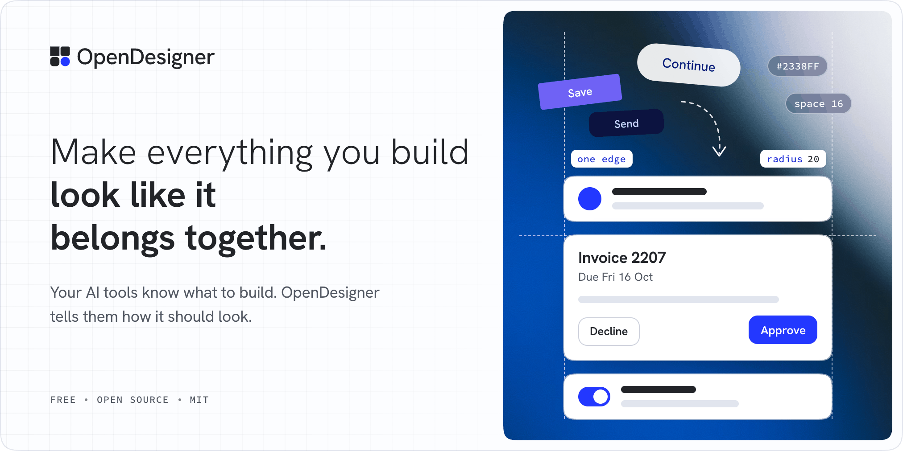
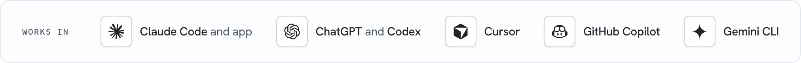
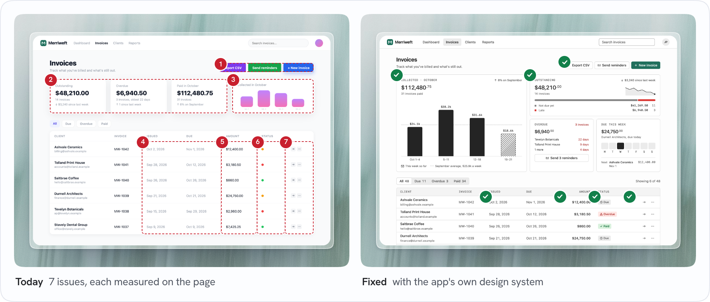
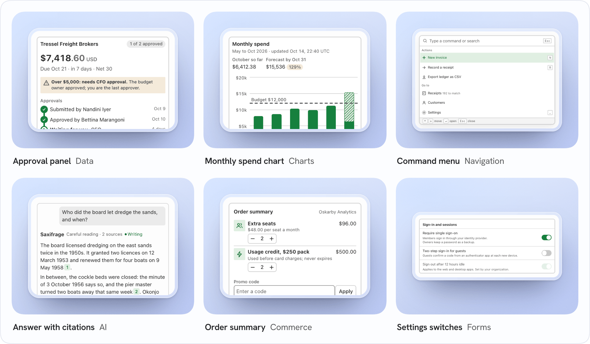
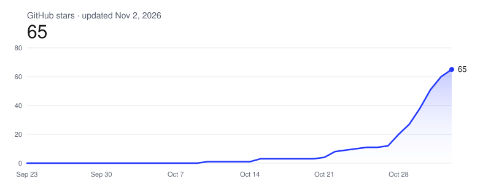

<p align="center">
  <a href="https://opendesigner.dev">
    <picture>
      <source media="(max-width: 600px)" srcset="https://raw.githubusercontent.com/ckryptickunal/OpenDesigner/main/brand/kit/readme/banner-narrow.png">
      
    </picture>
  </a>
</p>

<p align="center">
  <a href="https://opendesigner.dev"><b>Website</b></a> &nbsp;·&nbsp;
  <a href="https://opendesigner.dev/docs/">Docs</a> &nbsp;·&nbsp;
  <a href="https://opendesigner.dev/showcase/">Showcase</a> &nbsp;·&nbsp;
  <a href="#quickstart">Install</a> &nbsp;·&nbsp;
  <a href="CONTRIBUTING.md">Contribute</a> &nbsp;·&nbsp;
  <a href="https://calendar.app.google/42qSQUrBiSL4CHfv6">Book a 20-minute intro call</a>
</p>

**A free, open-source (MIT) add-on for your AI coding tool. It gives your product one design system and checks every screen against it.**

```
/plugin marketplace add ckryptickunal/OpenDesigner
/plugin install opendesigner@opendesigner
```

Two commands in Claude Code. Then up to five questions, planned at about 3 minutes, give you a first version.

On the Claude app, ChatGPT, Cursor or Codex, or have no terminal? [Pick your tool below](#quickstart).

<p align="center">
  <picture>
    <source media="(max-width: 600px)" srcset="https://raw.githubusercontent.com/ckryptickunal/OpenDesigner/main/brand/kit/readme/works-in-narrow.png">
    
  </picture>
</p>

## Two ways in

**Fix what you built.** It audits every button, font, size, color and alignment on your pages, marks each problem with the rule it breaks, and fixes it after your yes.

**Build a system.** It reads your repo, studies your competitors, proposes a positioning and three directions, then writes the rules your AI follows.

<picture>
  <source media="(max-width: 600px)" srcset="https://raw.githubusercontent.com/ckryptickunal/OpenDesigner/main/brand/kit/readme/before-after-narrow.png">
  
</picture>


## Every round

- **A plan you sign off,** step by step, written to `opendesigner/PROTOCOL.md` so any AI follows it.
- **Checks before you see it:** contrast, tap targets, type scale, letter-spacing, alignment, buttons, text over images.
- **Screenshots,** before and after. Not a link to open.
- **Your notes stick.** Say something twice and it becomes a rule.

## What lands in your repo

`DESIGN.md`, `PRODUCT.md`, design tokens (DTCG), CSS, Tailwind, Figma, Swift and Compose exports, a brand and press page, and a log of every choice with its reason.

## Quickstart

1. Add OpenDesigner to your AI tool. Pick yours below.
2. Open your project and say: **"Create a design system for this project."** Already built something? Say: **"Make this app look professional."** It audits first and changes nothing until you say yes.
3. Answer a few short questions. It reads your files first, so it asks less.

The audit measures your running app in a browser, so it needs a coding agent that can drive one or run Playwright, such as Claude Code. The ChatGPT bundle doesn't include it.

**Claude Code:** the two commands at the top of this page, then start a new session.

<details>
<summary><b>Claude app</b> (claude.ai or Desktop, no terminal)</summary>

Download [opendesigner.zip](https://opendesigner.dev/.well-known/agent-skills/opendesigner.zip) and upload it under Customize > Skills. Code execution must be on. That zip builds a system. To audit an app you already built, also upload [opendesigner-review.zip](https://opendesigner.dev/.well-known/agent-skills/opendesigner-review.zip) and [opendesigner-extract.zip](https://opendesigner.dev/.well-known/agent-skills/opendesigner-extract.zip). The [install guide](https://opendesigner.dev/docs/install/) lists the other seven.

To build the zips yourself, clone the repo and run `python3 tools/build_dist.py`. They land in `dist/`.

</details>

<details>
<summary><b>Codex, Cursor, VS Code with Copilot, Gemini CLI and other agents</b></summary>

These tools read skills from `.agents/skills/`. Run this inside your project. It copies in the ten skill folders and leaves nothing else behind.

```bash
git clone --depth 1 https://github.com/ckryptickunal/OpenDesigner .opendesigner-tmp
mkdir -p .agents/skills
cp -R .opendesigner-tmp/.agents/skills/opendesigner* .agents/skills/
rm -rf .opendesigner-tmp
```

Tools that support Agent Plugins can also read the root `plugin.json`.

</details>

<details>
<summary><b>ChatGPT</b> (a Project, nothing to install)</summary>

1. Download [opendesigner-chatgpt.zip](https://opendesigner.dev/downloads/opendesigner-chatgpt.zip) and unzip it.
2. Create a Project and paste `instructions.txt` into the Project instructions.
3. Upload the five files in the `knowledge` folder.

</details>

<details>
<summary><b>No AI at all</b> (the engine on its own)</summary>

The engine is one Python file (Python 3.10 or newer, nothing to install). It writes `DESIGN.md`, `PRODUCT.md` and an `opendesigner/` folder with tokens, exports and an overview page.

```bash
python3 path/to/OpenDesigner/skills/opendesigner/scripts/engine.py sketch --name "Acme" --feel friendly,minimal
```

</details>

You need your own AI tool and Python 3.10 or newer. The engine makes no network calls ([privacy](docs/PRIVACY.md)). Help for each tool: [install guide](https://opendesigner.dev/docs/install/).

Tested so far: the Claude Code install (2026-10-21) and the engine on Python 3.10.11. Not yet recorded: a run in the Claude app, Codex, Cursor, other agents or ChatGPT. Tried one? Say what you saw in [issue #19](https://github.com/ckryptickunal/OpenDesigner/issues/19) or in [Discussions](https://github.com/ckryptickunal/OpenDesigner/discussions).

New to the repo? You only need `skills/` or a zip from above. Everything else here (research, benchmarks, the website, the brand kit) is how OpenDesigner is made.

## Component library

<picture>
  <source media="(max-width: 600px)" srcset="https://raw.githubusercontent.com/ckryptickunal/OpenDesigner/main/brand/kit/readme/library-narrow.png">
  
</picture>


82 ready-made parts built only on your tokens. Optional. [Browse them](https://opendesigner.dev/library/).

## Smart UI

Optional. Your assistant answers with a part of your own system, like a list of flights, a fare comparison or a booking step, instead of three paragraphs. The model picks the part and fills in words and numbers. It can't pick a colour, a size or a link, every answer is checked before it shows, and anything that books, pays or deletes waits for the person to press a button. Plain HTML, so it works in any framework, and it speaks A2UI and MCP Apps. [See it](https://opendesigner.dev/smart-ui/) · [Add it to your assistant](https://opendesigner.dev/docs/smart-ui-quickstart/).

## Status

- Version 0.3.1, 11 November 2026. The first tagged release was 0.2.0, on 5 November. One maintainer.
- Engine tests pass locally. No CI runs, and no watched user trials yet.
- Next: choices you can click inside your AI tool ([#20](https://github.com/ckryptickunal/OpenDesigner/issues/20)).

[Changelog](CHANGELOG.md) · [How it works](docs/HOW-IT-WORKS.md) · [Research behind the defaults](docs/RESEARCH.md) · [Showcase](https://opendesigner.dev/showcase/)

## Help it get better

Tell your AI what went wrong. It saves the note and gives you a ready-to-file GitHub link; nothing is posted until you send it. Or [open an issue](https://github.com/ckryptickunal/OpenDesigner/issues/new/choose). Contributions: [CONTRIBUTING.md](CONTRIBUTING.md). Sponsorship: [docs/SPONSORSHIP.md](docs/SPONSORSHIP.md#for-sponsors).

<!-- Partners: large logos. Companies: small logos. Backers: names. Supported by: in-kind credit programs (never leave the wall empty). -->
<!-- When GitHub Sponsors is approved, point the link above at https://github.com/sponsors/ckryptickunal (see docs/SPONSORSHIP.md). -->

## Star history

<a href="https://github.com/ckryptickunal/OpenDesigner/stargazers">
  <picture>
    <source media="(prefers-color-scheme: dark)" srcset="brand/kit/readme/stars-dark.svg">
    
  </picture>
</a>

## License

Code, skills, templates and data files are under the [MIT license](LICENSE). Written research and documentation are under [CC BY 4.0](LICENSE-CONTENT), so you can reuse them with credit. That covers `research/`, `benchmarks/`, `sources/`, `traces/`, `synthesis/` Markdown and `docs/`. Product and design-system names in the research belong to their owners. The tool marks in the "works in" row belong to their owners and only show where OpenDesigner runs (from [Simple Icons](https://simpleicons.org), CC0). Photos in the README images are from Unsplash: [Philipp Hubert](https://unsplash.com/photos/dVVjhUcdb30) (banner), [Annie Spratt](https://unsplash.com/photos/5yKrcO8FKwM) (before and after), and [Adam Rasheed](https://unsplash.com/photos/BGEqCc-bQHg) and [Brina Blum](https://unsplash.com/photos/mNXTZu7AeGA) (component library).

To cite OpenDesigner or its research, use [CITATION.cff](CITATION.cff) (GitHub's "Cite this repository" button).
