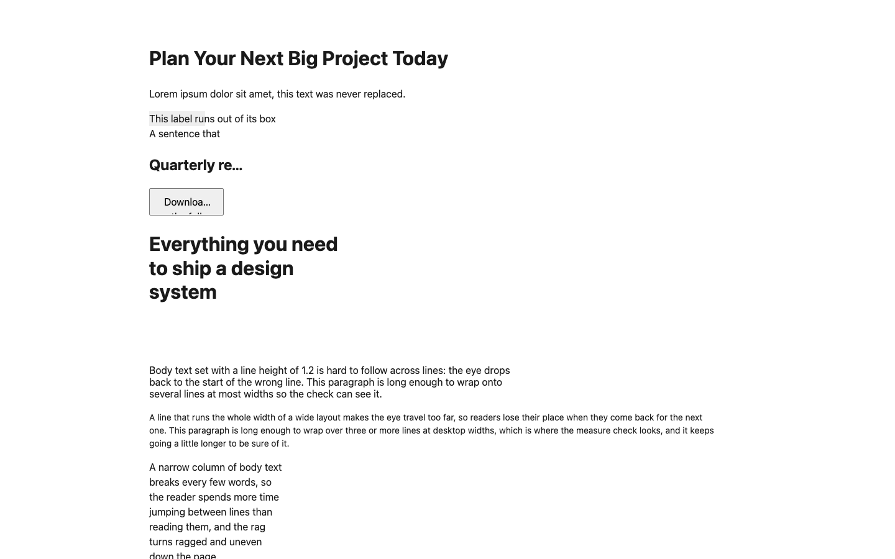
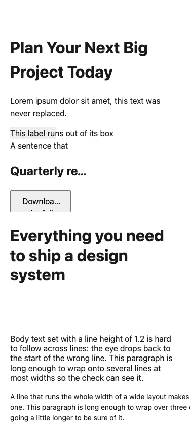
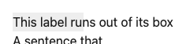
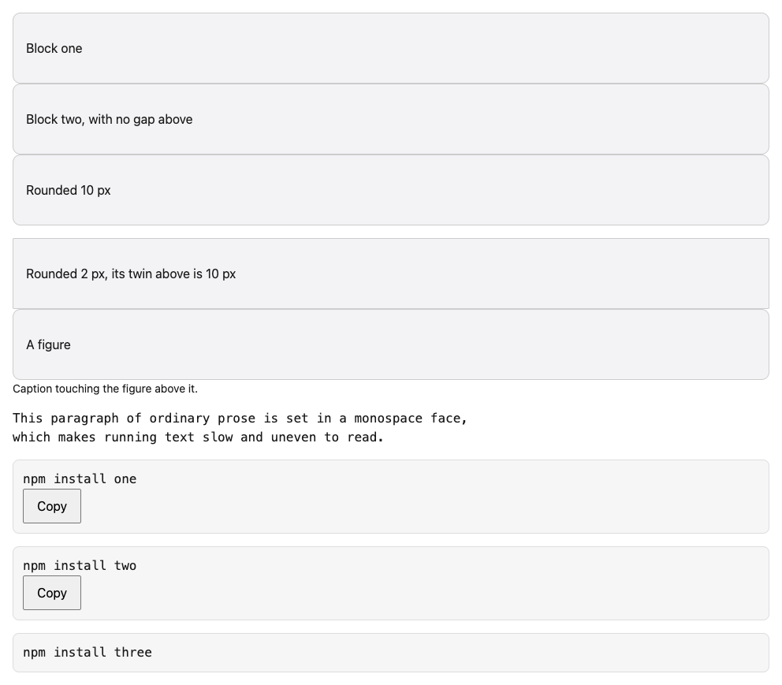
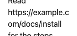
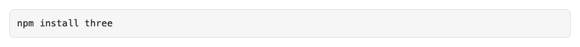
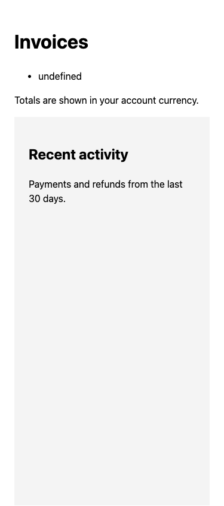

# Demo: the review catches cut-off text, cramped layouts, odd blocks, missing states and copy

This demo takes about 2 minutes from a clean folder. It runs the review on two test pages that contain every planted problem. It needs Python 3.10 or later, Playwright for Python, and Google Chrome. It uses the Chrome you already have (`--channel chrome`) and downloads no browser.

## Steps

1. Make a clean scratch folder. Playwright stays visible because `PYTHONUSERBASE` still points at your own user site:
   ```bash
   export PYTHONUSERBASE="$(python3 -c 'import site; print(site.getuserbase())')"
   D="$(mktemp -d)"; mkdir -p "$D/home" "$D/od" "$D/xdg"
   export HOME="$D/home" OD_HOME="$D/od" XDG_CONFIG_HOME="$D/xdg" GIT_CONFIG_GLOBAL=/dev/null
   cd "$D"
   ```
2. Get the branch:
   ```bash
   git clone -q --depth 1 --branch claude/elastic-elgamal-bc705c https://github.com/ckryptickunal/OpenDesigner repo && cd repo
   ```
3. Serve the test pages on your own machine only:
   ```bash
   python3 -m http.server 8799 --bind 127.0.0.1 --directory skills/opendesigner-review/scripts/fixtures &
   ```
4. Capture both pages at 375 and 1440 px. The run covers the stress passes, the slow network, the data states and the not-found page:
   ```bash
   python3 skills/opendesigner-review/scripts/capture.py --url http://127.0.0.1:8799 --routes /craft-bad.html,/states-bad.html --viewports 375,1440 --themes light --out "$D/review" --channel chrome --steps 2 --tabs 3
   ```
5. Read the findings, then write the report:
   ```bash
   python3 skills/opendesigner-review/scripts/review.py check "$D/review" --dir "$D/review"
   ```
   ```bash
   python3 skills/opendesigner-review/scripts/review.py report --dir "$D/review"
   ```
6. Run the same command on the fixed pages, `/craft-good.html,/states-good.html`. The craft and state findings are gone, with one exception: the not-found warnings (ST-18). Python's test server has no 404 page of its own, so it shows its bare "Error response" page. The live test serves `fixtures/404.html` instead, and no ST-18 finding fires there.

## What you should see

On 2026-11-13 the bad pages took 90 seconds. Every one of the 19 new review cases fired. Each finding gives:
- the element (a selector)
- the measured number
- a crop in `review/shots/crops/`
- a fix, which names your tokens when you pass `--project` with an OpenDesigner system

| | |
|---|---|
| The bad page at 1440 px  | At 375 px  |
| ST-12: a label runs out of its box  | MS-25: sibling boxes, 10 px and 2 px corners  |
| MS-27: an address broken across lines  | ST-15: the code block with no Copy button  |
| ST-16: the list after a failed request prints "undefined"  | |

The live tests (`skills/opendesigner-review/scripts/test_probe_live.py`) run the same pages, assert each finding on the bad pages, and assert none on the good pages.
