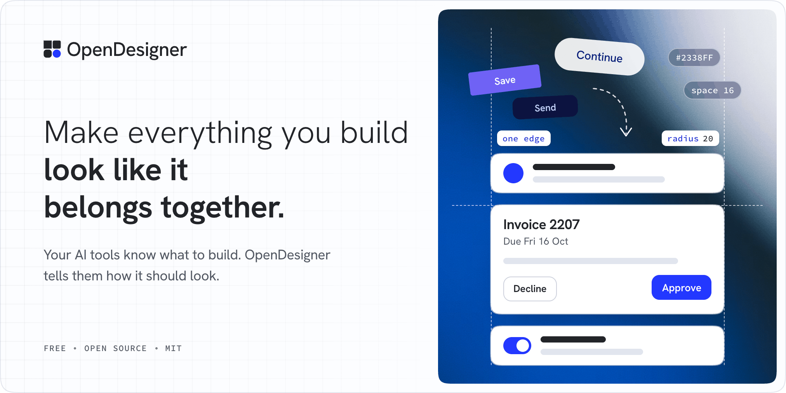
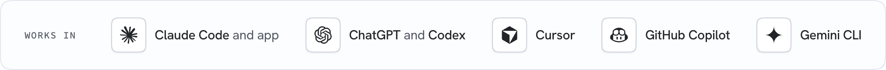
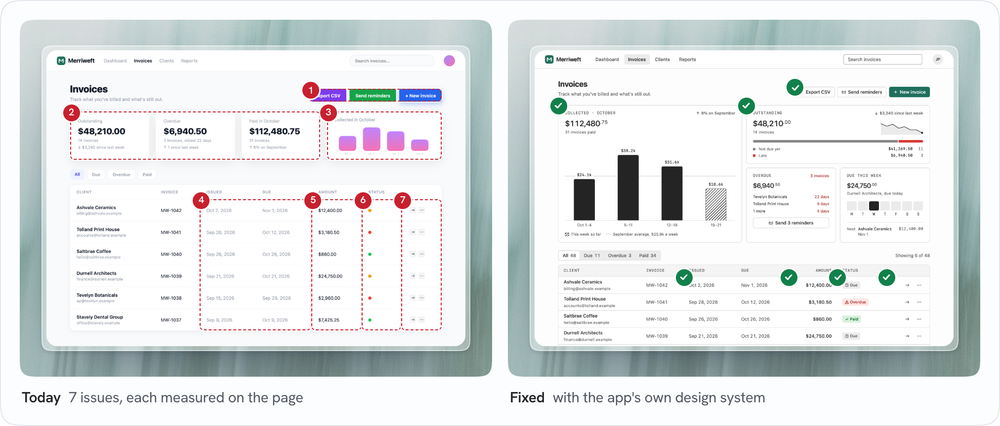
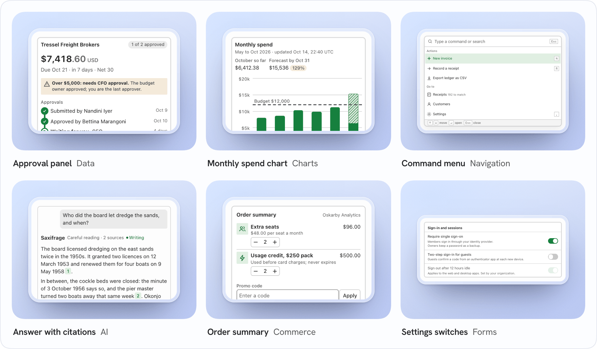
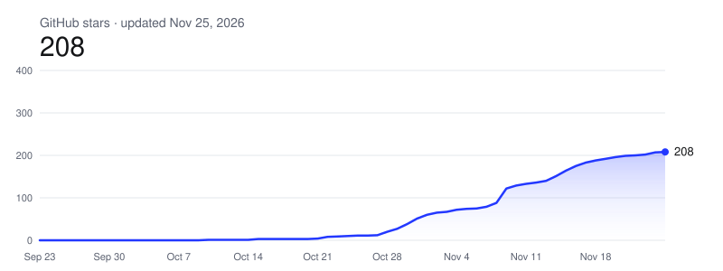

# OpenDesigner en español

> Esta es una traducción de la documentación. La versión original en inglés está en [README.md](https://github.com/ckryptickunal/OpenDesigner/blob/main/README.md) y es la fuente canónica si alguna traducción queda desactualizada. Los comandos, nombres de archivos, bloques de código y enlaces a otras guías se conservan en inglés para que coincidan con el proyecto.

<p align="center">
  <a href="https://opendesigner.dev">
    <picture>
      <source media="(max-width: 600px)" srcset="https://raw.githubusercontent.com/ckryptickunal/OpenDesigner/main/brand/kit/readme/banner-narrow.png">
      
    </picture>
  </a>
</p>

<p align="center">
  <a href="https://opendesigner.dev"><b>Sitio web</b></a> &nbsp;·&nbsp;
  <a href="https://opendesigner.dev/docs/">Documentación</a> &nbsp;·&nbsp;
  <a href="https://opendesigner.dev/showcase/">Galería</a> &nbsp;·&nbsp;
  <a href="#inicio-rápido">Instalación</a> &nbsp;·&nbsp;
  <a href="https://github.com/ckryptickunal/OpenDesigner/blob/main/CONTRIBUTING.md">Contribuir</a> &nbsp;·&nbsp;
  <a href="https://calendar.app.google/42qSQUrBiSL4CHfv6">Reserva una llamada introductoria de 20 minutos</a>
</p>

**Un complemento gratuito y de código abierto (MIT) para tu herramienta de programación con IA. Da a tu producto un sistema de diseño y comprueba cada pantalla con sus reglas.**

```
/plugin marketplace add ckryptickunal/OpenDesigner
/plugin install opendesigner@opendesigner
```

Dos comandos en Claude Code. Después, hasta cinco preguntas, previstas para unos 3 minutos, crean una primera versión.

¿Usas la aplicación de Claude, ChatGPT, Cursor o Codex, o no tienes terminal? [Elige tu herramienta más abajo](#inicio-rápido).

<p align="center">
  <picture>
    <source media="(max-width: 600px)" srcset="https://raw.githubusercontent.com/ckryptickunal/OpenDesigner/main/brand/kit/readme/works-in-narrow.png">
    
  </picture>
</p>

## Dos formas de empezar

**Mejora lo que ya construiste.** Revisa cada botón, fuente, tamaño, color y alineación de tus páginas, señala cada problema con la regla que incumple y lo corrige cuando das tu aprobación.

**Crea un sistema.** Lee tu repositorio, estudia a tus competidores, propone un posicionamiento y tres direcciones, y luego escribe las reglas que seguirá tu IA.

<picture>
  <source media="(max-width: 600px)" srcset="https://raw.githubusercontent.com/ckryptickunal/OpenDesigner/main/brand/kit/readme/before-after-narrow.png">
  
</picture>

## Smart UI

**Responde con una interfaz, no con párrafos.** Tu asistente muestra una parte de tu propio sistema, como una multa con un botón para pagar, preparada de antemano a partir de tus componentes. Tus datos la completan y eligen sus colores. Cualquier acción de pago o reserva pide confirmación primero.

<picture>
  <source media="(max-width: 600px)" srcset="https://raw.githubusercontent.com/ckryptickunal/OpenDesigner/main/brand/kit/readme/smart-ui-live-narrow.png">
  
</picture>

<picture>
  <source media="(max-width: 600px)" srcset="https://raw.githubusercontent.com/ckryptickunal/OpenDesigner/main/brand/kit/readme/smart-ui-screens-narrow.png">
  
</picture>

[Ver la demostración grabada](https://opendesigner.dev/smart-ui/) · [Añadirlo a tu asistente](https://opendesigner.dev/docs/smart-ui-quickstart/)

## Cada ciclo

- **Un plan que apruebas**, paso a paso, guardado en `opendesigner/PROTOCOL.md` para que cualquier IA lo siga.
- **Comprobaciones antes de verlo:** contraste, áreas táctiles, escala tipográfica, espaciado entre letras, alineación, botones y texto sobre imágenes.
- **Capturas de pantalla** del antes y el después, no solo un enlace para abrir.
- **Tus notas permanecen.** Si dices algo dos veces, se convierte en una regla.

## Qué se guarda en tu repositorio

`DESIGN.md`, `PRODUCT.md`, tokens de diseño (DTCG), exportaciones para CSS, Tailwind, Figma, Swift y Compose, una página de marca y prensa, y un registro de cada decisión con su motivo.

## Inicio rápido

1. Añade OpenDesigner a tu herramienta de IA. Elige una opción más abajo.
2. Abre tu proyecto y di: **"Create a design system for this project."** ¿Ya construiste algo? Di: **"Make this app look professional."** Primero lo revisa y no cambia nada hasta que lo apruebes.
3. Responde unas pocas preguntas breves. Primero lee tus archivos, así que pregunta menos.

La auditoría mide tu aplicación en ejecución dentro de un navegador. Necesita un agente de programación que pueda controlarlo o ejecutar Playwright, como Claude Code. El paquete de ChatGPT no incluye esa función.

**Claude Code:** ejecuta los dos comandos del principio de esta página y luego inicia una sesión nueva.

<details>
<summary><b>Aplicación de Claude</b> (claude.ai o Desktop, sin terminal)</summary>

Descarga [opendesigner.zip](https://opendesigner.dev/.well-known/agent-skills/opendesigner.zip) y súbelo en Customize > Skills. La ejecución de código debe estar activada. Ese archivo ZIP crea un sistema. Para auditar una aplicación existente, sube también [opendesigner-review.zip](https://opendesigner.dev/.well-known/agent-skills/opendesigner-review.zip) y [opendesigner-extract.zip](https://opendesigner.dev/.well-known/agent-skills/opendesigner-extract.zip). La [guía de instalación](https://opendesigner.dev/docs/install/) enumera las otras siete.

Para crear los ZIP tú mismo, clona el repositorio y ejecuta `python3 tools/build_dist.py`. Se guardan en `dist/`.

</details>

<details>
<summary><b>Codex, Cursor, VS Code con Copilot, Gemini CLI y otros agentes</b></summary>

Estas herramientas leen las habilidades desde `.agents/skills/`. Ejecuta esto dentro de tu proyecto. Copia las diez carpetas de habilidades y no deja nada más.

```bash
git clone --depth 1 https://github.com/ckryptickunal/OpenDesigner .opendesigner-tmp
mkdir -p .agents/skills
cp -R .opendesigner-tmp/.agents/skills/opendesigner* .agents/skills/
rm -rf .opendesigner-tmp
```

Las herramientas compatibles con Agent Plugins también pueden leer el archivo raíz `plugin.json`.

</details>

<details>
<summary><b>ChatGPT</b> (un Project, no hace falta instalar nada)</summary>

1. Descarga [opendesigner-chatgpt.zip](https://opendesigner.dev/downloads/opendesigner-chatgpt.zip) y descomprímelo.
2. Crea un Project y pega `instructions.txt` en las instrucciones del Project.
3. Sube los cinco archivos de la carpeta `knowledge`.

</details>

<details>
<summary><b>Sin IA</b> (solo el motor)</summary>

El motor es un único archivo de Python (Python 3.10 o posterior; no hay que instalar nada). Escribe `DESIGN.md`, `PRODUCT.md` y una carpeta `opendesigner/` con tokens, exportaciones y una página de resumen.

```bash
python3 path/to/OpenDesigner/skills/opendesigner/scripts/engine.py sketch --name "Acme" --feel friendly,minimal
```

</details>

Necesitas tu propia herramienta de IA y Python 3.10 o posterior. El motor no hace llamadas de red ([privacidad](https://github.com/ckryptickunal/OpenDesigner/blob/main/docs/PRIVACY.md)). Ayuda para cada herramienta: [guía de instalación](https://opendesigner.dev/docs/install/).

Hasta ahora se ha probado la instalación de Claude Code (2026-10-21) y el motor con Python 3.10.11. Aún no hay pruebas grabadas en la aplicación de Claude, Codex, Cursor, otros agentes o ChatGPT. ¿Lo probaste? Cuéntanos qué viste en [el issue #19](https://github.com/ckryptickunal/OpenDesigner/issues/19) o en [Discussions](https://github.com/ckryptickunal/OpenDesigner/discussions).

¿Eres nuevo en el repositorio? Solo necesitas `skills/` o un ZIP de arriba. El resto (investigación, evaluaciones comparativas, sitio web y kit de marca) explica cómo se crea OpenDesigner.

## Biblioteca de componentes

<picture>
  <source media="(max-width: 600px)" srcset="https://raw.githubusercontent.com/ckryptickunal/OpenDesigner/main/brand/kit/readme/library-narrow.png">
  
</picture>

129 componentes listos, construidos solo con tus tokens, cada uno con textos y números marcados para que una aplicación o un asistente pueda completarlos. Son opcionales. [Explóralos](https://opendesigner.dev/library/).

## Estado

- Versión 0.3.1, 11 de noviembre de 2026. La primera versión etiquetada fue la 0.2.0, el 5 de noviembre. Hay una persona mantenedora.
- Las pruebas del motor pasan localmente. No hay ejecuciones de CI ni pruebas de usuario observadas todavía.
- Próximo paso: opciones que puedes pulsar dentro de tu herramienta de IA ([#20](https://github.com/ckryptickunal/OpenDesigner/issues/20)).

[Registro de cambios](https://github.com/ckryptickunal/OpenDesigner/blob/main/CHANGELOG.md) · [Cómo funciona](https://github.com/ckryptickunal/OpenDesigner/blob/main/docs/HOW-IT-WORKS.md) · [Investigación que respalda los valores predeterminados](https://github.com/ckryptickunal/OpenDesigner/blob/main/docs/RESEARCH.md) · [Galería](https://opendesigner.dev/showcase/)

## Ayúdanos a mejorarlo

Cuéntale a tu IA qué salió mal. Guardará una nota y te dará un enlace de GitHub listo para enviar; no se publica nada hasta que lo envíes. También puedes [abrir un issue](https://github.com/ckryptickunal/OpenDesigner/issues/new/choose). Para contribuir, consulta [CONTRIBUTING.md](https://github.com/ckryptickunal/OpenDesigner/blob/main/CONTRIBUTING.md). Para patrocinar, visita [docs/SPONSORSHIP.md](https://github.com/ckryptickunal/OpenDesigner/blob/main/docs/SPONSORSHIP.md#for-sponsors).

<!-- Partners: large logos. Companies: small logos. Backers: names. Supported by: in-kind credit programs (never leave the wall empty). -->
<!-- When GitHub Sponsors is approved, point the link above at https://github.com/sponsors/ckryptickunal (see docs/SPONSORSHIP.md). -->

## Historial de estrellas

<a href="https://github.com/ckryptickunal/OpenDesigner/stargazers">
  <picture>
    <source media="(prefers-color-scheme: dark)" srcset="https://raw.githubusercontent.com/ckryptickunal/OpenDesigner/main/brand/kit/readme/stars-dark.svg">
    
  </picture>
</a>

## Licencia

El código, las habilidades, las plantillas y los archivos de datos están bajo la [licencia MIT](https://github.com/ckryptickunal/OpenDesigner/blob/main/LICENSE). La investigación escrita y la documentación están bajo [CC BY 4.0](https://github.com/ckryptickunal/OpenDesigner/blob/main/LICENSE-CONTENT), por lo que puedes reutilizarlas con atribución. Esto incluye `research/`, `benchmarks/`, `sources/`, `traces/`, los archivos Markdown de `synthesis/` y `docs/`. Los nombres de productos y sistemas de diseño mencionados en la investigación pertenecen a sus propietarios. Las marcas de herramientas en la fila «Funciona con» pertenecen a sus propietarios y solo muestran dónde se ejecuta OpenDesigner (proceden de [Simple Icons](https://simpleicons.org), CC0). Las fotos de las imágenes del README son de Unsplash: [Philipp Hubert](https://unsplash.com/photos/dVVjhUcdb30) (banner), [Annie Spratt](https://unsplash.com/photos/5yKrcO8FKwM) (antes y después), y [Adam Rasheed](https://unsplash.com/photos/BGEqCc-bQHg) y [Brina Blum](https://unsplash.com/photos/mNXTZu7AeGA) (biblioteca de componentes).

Para citar OpenDesigner o su investigación, usa [CITATION.cff](https://github.com/ckryptickunal/OpenDesigner/blob/main/CITATION.cff) (el botón «Cite this repository» de GitHub).
