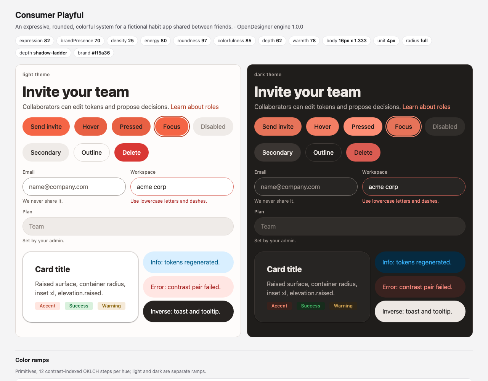

# Consumer Playful

An expressive, rounded, colorful system for a fictional habit app shared between friends.

**Dials:** expression 82 · brandPresence 70 · density 25 · energy 80 · roundness 97 · colorfulness 85 · depth 62 · warmth 78.

| What | Result |
|---|---|
| Type | body 16px, ratio 1.333, sizes 12, 16, 21, 28, 38; weights body 400, label 500, heading 750 |
| Space | 4px unit; default density spacious (controls 40/48/56px); hit areas pointer 24px, touch 48px |
| Shape | control radius full, containers 24px, focus ring 2px |
| Depth | shadow-ladder |
| Motion | medium 280ms, spring damping 0.76 |
| Color | expressive scheme, accent solid `#ff5a36`, text minimum 4.5:1, themes light, dark |
| Validation | 0 errors, 0 warnings, 7 notes; 192 contrast pairs checked |

**Files:** `state.json` (the input), `decisions.md` (why each choice), `tokens/` (DTCG 2025.10 + resolver, canonical), `build/` (artifact, compose, css, dtcg, figma, paper, swift, tailwind), `DESIGN.md`, `PRODUCT.md`, `overview.html` (the whole system on one page), `preview.html` and `preview/` (the visual templates, filled in).

**Rebuild:** `python3 tools/build_examples.py consumer-playful` runs `engine.py build` on `state.json` and rewrites this README. `python3 tools/build_examples.py --check` fails when a committed file differs from what the engine makes now.

The product is fictional; no real brand's identity is copied.
