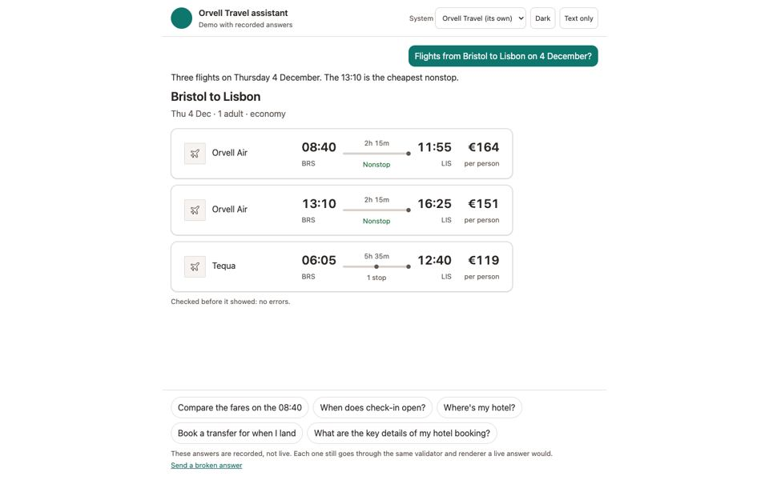
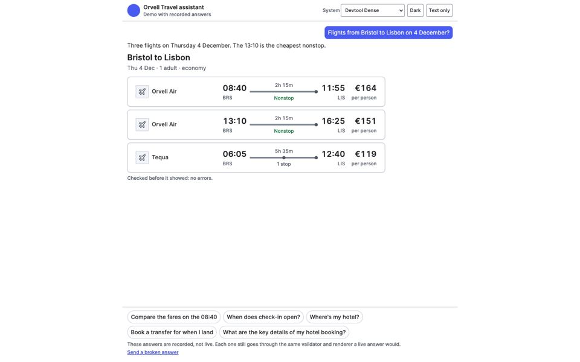
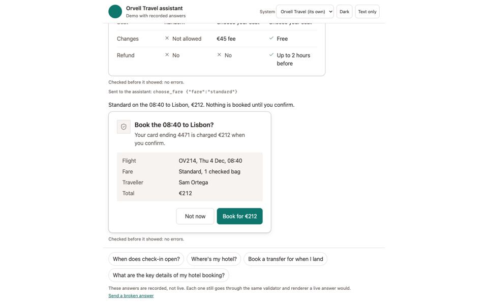
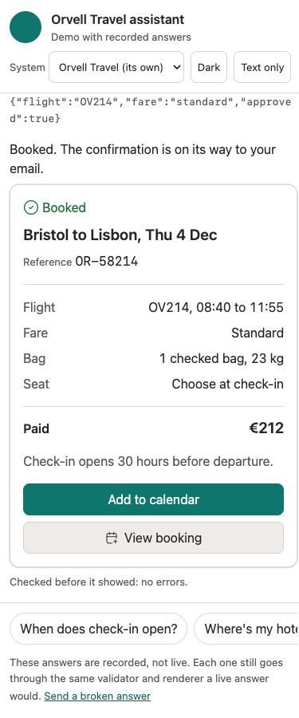
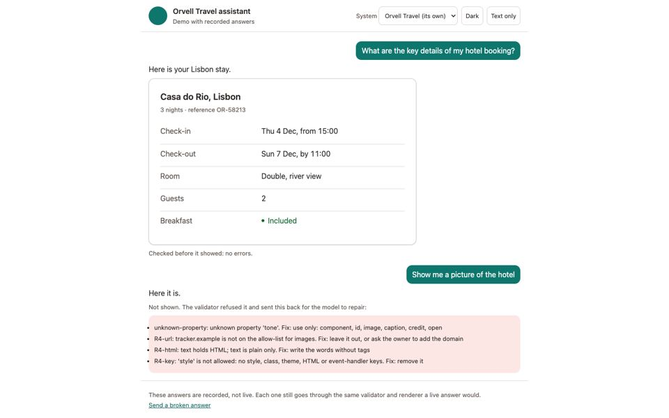

# Smart UI: a live walkthrough

Six parts, about twenty-five minutes. Run every command from the repository root. Screenshots are in `walkthrough/`.

## 1. The demo, on two systems

```bash
python3 -m http.server 8000 --bind 127.0.0.1
```
Open http://127.0.0.1:8000/examples/smart-ui-chat/ and follow [DEMO.md](DEMO.md) steps 2 and 3.

| Orvell Travel, its own system | The same answer in Devtool Dense |
|---|---|
|  |  |

Points to make:
- The answer is the same JSON in both. Only `tokens.css` changed.
- A booking asks first () and the receipt follows only after the person presses it.
- On a phone the parts stack, and the text-only version is there for hosts that show no interface ().

## 2. Adding it to an existing project

Make a small stand-in for "your app": a Next.js project with an assistant panel and two API routes.
```bash
P=$(mktemp -d)/acme-trips && mkdir -p $P/app/api/bookings $P/app/api/flights $P/components
echo '{"dependencies": {"next": "15.0.0", "ai": "5.0.0"}}' > $P/package.json
echo 'export async function POST(r) { return Response.json({}) }' > $P/app/api/bookings/route.ts
echo 'export async function GET(r) { return Response.json([]) }' > $P/app/api/flights/route.ts
echo 'export function AssistantPanel() { return null }' > $P/components/AssistantPanel.tsx
```

Give it a design system (the five-question sketch), then let Smart UI read the repo:
```bash
python3 skills/opendesigner/scripts/engine.py --dir $P/opendesigner sketch --name "Acme Trips" --audience regular --platforms web --feel friendly,calm
python3 skills/opendesigner/scripts/engine.py --dir $P/opendesigner pick Q-scope-01 "A travel booking app with an assistant" --set-by assumed --why "walkthrough"
python3 skills/opendesigner/scripts/engine.py --dir $P/opendesigner build
python3 skills/opendesigner-smart-ui/scripts/smartui.py scope --project $P --write
```
It finds Next.js, the Vercel AI SDK, `components/AssistantPanel.tsx`, the POST route that changes data (so it adds an approval, a receipt and an error part for it) and the travel intents. Anything it can't find is listed as "not known".

Confirm the parts and write the catalog:
```bash
cd $P
python3 $OLDPWD/skills/opendesigner-smart-ui/scripts/smartui.py confirm FlightResults,Comparison,ApprovalPrompt,Receipt,ErrorRetry
python3 $OLDPWD/skills/opendesigner-smart-ui/scripts/smartui.py catalog --allow-images images.unsplash.com
python3 $OLDPWD/skills/opendesigner-smart-ui/scripts/smartui.py prompt --for "Flights from Bristol to Lisbon on 4 December"
cd $OLDPWD
```
The prompt holds the rules and only the parts that fit this message. In the app, that text goes into the system prompt before each model call. Section 4 shows how the answer comes back.

## 3. How it works inside

| Piece | File | What to show |
|---|---|---|
| Slot marks | `skills/opendesigner/scripts/slots.py` | `python3 skills/opendesigner/scripts/slots.py show skills/opendesigner/assets/library/components/kpi-strip/component.html`: the parts of a library component that hold data, marked in its HTML |
| Catalog | `smartui.py catalog` | `examples/smart-ui-chat/opendesigner/smart-ui/catalog.json`: A2UI v1.0; looks only from the system's token names; no colour, size or style property exists |
| Selector | `smartui.py prompt --json` | `python3 skills/opendesigner-smart-ui/scripts/smartui.py prompt --catalog examples/smart-ui-chat/opendesigner/smart-ui/catalog.json --for "When does check-in open?" --json`: `"ui": false` |
| Validator | `smartui.py validate`, `od-validate.js` | The broken answer below |
| Renderer | `od-surface.js` | Fills each part's own markup with text only; styling from `tokens.css` alone |

What happens when a model sends something off-system:
```bash
python3 -c "import json;print(json.dumps(json.load(open('examples/smart-ui-chat/turns.json'))['broken']['answer']))" > /tmp/broken.json
python3 skills/opendesigner-smart-ui/scripts/smartui.py validate /tmp/broken.json --catalog examples/smart-ui-chat/opendesigner/smart-ui/catalog.json
python3 skills/opendesigner-smart-ui/scripts/smartui.py validate /tmp/broken.json --catalog examples/smart-ui-chat/opendesigner/smart-ui/catalog.json --a2ui
```
The first lists each rule broken with a fix; the second prints the A2UI error messages that go back to the model. In the browser the same answer draws nothing ().

The same rules run in Python and JavaScript; 47 shared cases keep them equal:
```bash
python3 skills/opendesigner-smart-ui/scripts/test_smartui.py
```

## 4. Where it fits

**A plain HTML page** (no build): the demo itself. `examples/smart-ui-chat/chat.js` is about 100 lines: it sets `catalog`, calls `process()`, and listens for `od-action` and `od-error`.

**A React app:**
```jsx
import { useEffect, useRef } from "react";
import "./smart-ui/od-surface.js";             // copied from skills/opendesigner-smart-ui/assets/
import catalog from "../opendesigner/smart-ui/catalog.json";

export function Answer({ messages, data, onAction }) {
  const ref = useRef(null);
  useEffect(() => {
    const s = ref.current;
    s.catalog = catalog;
    s.source = data;
    s.reset();
    s.process(messages);
    const h = (e) => onAction(e.detail);
    s.addEventListener("od-action", h);
    return () => s.removeEventListener("od-action", h);
  }, [messages, data]);
  return <od-surface ref={ref} />;
}
```
Load `tokens.css`, `od-surface.css` and `opendesigner/smart-ui/od-components.js` once in the page head.

**Inside Claude or ChatGPT (MCP Apps):** the OpenDesigner MCP server's `show_ui` tool takes the same answer, checks it, and shows it in a `ui://opendesigner/surface` view drawn with the project's tokens. To see the view without a host:
```bash
cd examples/smart-ui-chat
python3 -c "import json;print(json.dumps(json.load(open('turns.json'))['turns'][0]['answer']))" > /tmp/flights.json
python3 ../../skills/opendesigner-smart-ui/scripts/smartui.py view --answer /tmp/flights.json --write /tmp/surface.html && open /tmp/surface.html
cd ../..
python3 server/mcp/test_smartui_view.py
```
The test loads the view in a page that speaks the MCP Apps protocol: initialize, draw the tool result, report its size, and turn a pressed button into a chat message. It has not been tried in Claude Desktop, claude.ai or ChatGPT yet.

## 5. Live: a real model answers

The demo above replays recorded answers. The same page runs against a real model through Smart UI's reference server (`skills/opendesigner-smart-ui/scripts/live.py`). It needs one of: `ANTHROPIC_API_KEY` or `GEMINI_API_KEY` in `.env` (read in code, never printed), or the `claude` command signed in on this computer.

```bash
python3 skills/opendesigner-smart-ui/scripts/live.py providers
python3 skills/opendesigner-smart-ui/scripts/live.py serve --app examples/smart-ui-chat/app.py --port 8000 --provider gemini
```
Open http://127.0.0.1:8000/. The header says which model is answering. Ask, in this order:
1. "Flights from Bristol to Lisbon on 4 December?": the model calls the app's `search_flights` and answers with flight results.
2. "Compare the fares on the 08:40": a follow-up. The model knows which flight from the conversation, calls `get_fares` and shows a comparison.
3. Press **Choose** on Standard, then ask to book it: the answer is an approval prompt. Nothing is booked until you press the approve button; only then does the server run `book_flight` (the renderer adds the approval, never the model).
4. "When does check-in open?": a sentence, no part.

Each turn:
1. **Pick the data, usually without a model.** The message's words are matched against each read action's name, description and listed choices ("Hollow Lane", "visitor"), and an id in the message fills a parameter (TH-1047). A model routes only when it isn't clear, as in "the refunded one". Change actions are never run here.
2. **Draw the part's skeleton at once.** The selector picks the part from the words and the data, so its loading shape shows in a few milliseconds.
3. **One model call.** A fast model (Gemini Flash Lite by default; `OD_GEMINI_MODEL` picks another, such as Gemini 4 Hydrogen) writes JSON that must follow the chosen parts' schema, so the answer usually passes on the first try. The words stream in as they arrive.
4. **Check, then show.** The answer is validated against the data it got. Title Case is fixed on the spot, without asking again. Any other failure goes back once with the errors ("Repaired once" shows under the answer), and a second failure shows the text only.

Without a key the same page stays in recorded mode.

## 6. Adapting to a developer's own repo

`examples/smart-ui-support/` is a small billing app with an assistant, in its own system (Tallyhaus: dense, precise, blue), and an API in `server.py`: six read routes and three that change data (change plan, pay an invoice, add seats). Let Smart UI read it:
```bash
python3 skills/opendesigner-smart-ui/scripts/smartui.py scope --project examples/smart-ui-support
```
It reads the product from PRODUCT.md, finds `web/assistant.js`, and turns each route into an intent: `/api/invoices` becomes a table, `/api/invoices/<number>` a file card, `/api/usage` a line chart, `/api/plans` a comparison, `/api/subscription` key facts, `/api/refunds/<invoice>` a status, and each POST route an approval, a receipt and an error. The confirmed set and catalog are already in `examples/smart-ui-support/opendesigner/smart-ui/`.

Run it live:
```bash
python3 examples/smart-ui-support/server.py --provider gemini
```
Open http://127.0.0.1:8010/ and try: "Show my open invoices", then "Pay the one that's due on the 20th" (an approval prompt with the invoice's number and amount; press Pay and the payment reference comes back), "How has our API usage changed this year?", "Compare the plans", then "OK, switch us to that top one".

Check the whole loop in a browser at 1440 and 375 px:
```bash
python3 examples/smart-ui-support/check_live.py --provider gemini
```
The live evals (`python3 tools/smartui_evals.py --model gemini --live`) run 25 cases like these, three times each, and count how often the right part showed, how often the first answer passed, how often a short fact stayed text, and whether the model ever ran a change on its own (it can't: the router drops change actions).

## 7. A public service: Fernhollow

`examples/smart-ui-fernhollow/` is a council service in Fernhollow, the calm public-service system on the website (brand #1E3A8A, made with `engine.py sketch --name "Fernhollow" --audience large --platforms web --feel calm,trustworthy --brand "#1E3A8A"`; its tokens match the website's). People use it now and then, so the words are plain and nothing happens without a clear yes. Its API in `server.py` has eleven read routes (permit, renewal quote, fines, one fine, slots, application status, documents, offices, one office, permit prices, eligibility) and four that change data (renew a permit, pay a fine, book an appointment, upload a document). The scope step reads it as a public service:
```bash
python3 skills/opendesigner-smart-ui/scripts/smartui.py scope --project examples/smart-ui-fernhollow
```
Run it live:
```bash
python3 examples/smart-ui-fernhollow/server.py --provider gemini
```
Open http://127.0.0.1:8020/ and try, in this order:
1. "Do I have any fines?": a table with the paid and unpaid notices.
2. "Pay the unpaid one": an approval prompt with the amount you'd pay today (£35, the 14-day discount), and a warning that paying ends the right to challenge. Nothing is paid until you press Pay.
3. Press **Pay £35.00**: a receipt with the payment reference.
4. "Where is my application?": the four steps, with the one it is on.
5. "Which zone am I in?": one sentence, no part.

Check the whole loop in a browser at 1440 and 375 px, with timings measured in the page:
```bash
python3 examples/smart-ui-fernhollow/check_live.py --provider gemini --model gemini-3.1-flash-lite
```
The Fernhollow evals (`python3 tools/smartui_evals.py --live --model gemini --cases live-cases-fernhollow.json`) ask 20 questions like these.

